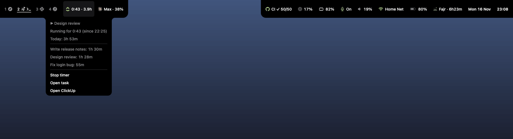

# wingbar-widgets

Widgets for [wingbar](https://github.com/iammosab/wingbar), the light native macOS status bar.
Each one is a small script with a hover menu that wingbar draws in the bar's own colours, hanging
from the wing.



*All seven, on [demo data](scripts/demo): `scripts/demo/config.sh DIR` writes a wingbar
settings file that runs every widget on made-up answers, for trying the menus without accounts.*

| Widget | Shows | Menu | Needs |
|---|---|---|---|
| [ci](widgets/ci) | A GitHub repo's Actions: `CI ✓ 48/48` | Today's runs and pass rate, recent runs, open PRs and their checks | `gh` |
| [claude](widgets/claude) | Your Claude plan usage: `25%` | Each limit and when it resets, usage credits | Claude Code, signed in |
| [clickup](widgets/clickup) | The running ClickUp timer and today's total | Today's time per task, start/stop timer, open the task | A ClickUp API token |
| [memory](widgets/memory) | RAM in use, coloured by memory pressure | Used, app/wired/compressed, swap, the apps using the most | — |
| [mic](widgets/mic) | Whether the microphone is muted | Input device and volume, mute/unmute | — (a mute switch with the Command Line Tools) |
| [network](widgets/network) | The connection in use: Wi-Fi or Ethernet | Every live link, Wi-Fi signal, rate and channel, router, VPNs, copy IP | — |
| [salat](widgets/salat) | The next prayer and time left (Morocco): `Asr · 1h05m` | Today's six times, optional "mark as prayed" | `python3` |

## Install

[Install wingbar](https://github.com/iammosab/wingbar#install) first, then pick widgets:

```bash
curl -fsSL https://raw.githubusercontent.com/iammosab/wingbar-widgets/main/install.sh | bash -s -- ci salat
```

or from a clone: `./install.sh ci salat` (`./install.sh --list` lists them). Each widget's folder
goes to `~/.config/wingbar/widgets/<name>/` and the widget is added to the right wing; run the
command again to update the scripts.

Then open `~/.config/wingbar/config.json` and fill in the widget's settings: they're the variables
at the start of its `command`, with placeholders such as `WINGBAR_CI_REPO=owner/repo`. Each
widget's README lists them. Secrets (the ClickUp token) go in `~/.config/wingbar/secrets.env`,
which stays on your Mac.

You can also paste a widget's `widget.json` under `"widgets"` in `config.json` yourself, and add
its name to `"left"` or `"right"`.

## Privacy

Every widget's README ends with a **Privacy** section: what it reads, what it sends and where,
and what it stores. In short:

- **memory, mic, network:** local only; they send nothing.
- **ci:** talks to GitHub through your `gh`; it never reads your token.
- **claude:** reads your own Claude Code sign-in from the Keychain at run time and sends it only to
  Anthropic, to read your usage (an undocumented endpoint Claude Code uses; it may change). The
  token is never written anywhere.
- **clickup:** sends your token only to ClickUp's API.
- **salat:** downloads the public Habous timetable; with `WINGBAR_SALAT_CITY=auto` your IP goes to
  ipinfo.io to find the nearest city.

Caches live in `$TMPDIR/wingbar-<name>/`.

## Writing your own

A widget is a script that prints `level|label` on its first line, and `menu:` lines for its menu:

```text
ok|CI ✓ 48/48
menu: Today: 50 runs · 48/48 passed      a reading (shown dimmed)
menu: ---                                 a separator
menu: Open Actions | open 'https://…'     an action
```

[CONVENTIONS.md](CONVENTIONS.md) has the rules the widgets here follow: layout, settings,
secrets, failing quietly, and keeping anything personal out. `scripts/check.sh` checks syntax,
each `widget.json`, and that no home path, email, private IP, MAC address or token is in the
files; list your own words to keep out in `.leakwords` (git-ignored). CI runs it on every push.

## License

MIT
